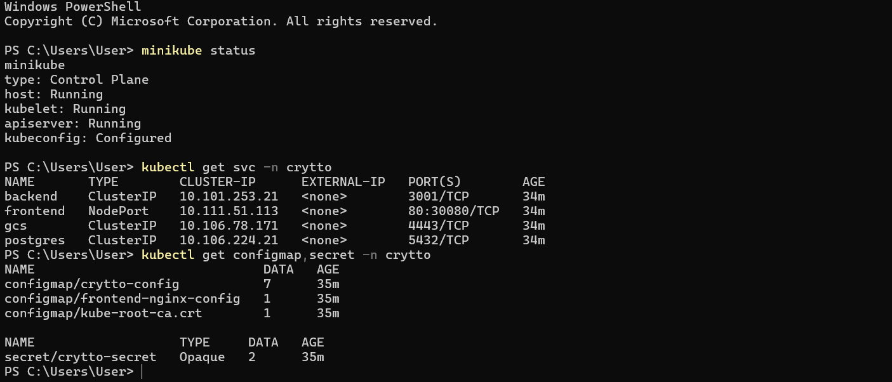
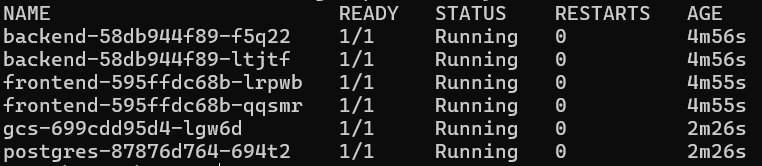
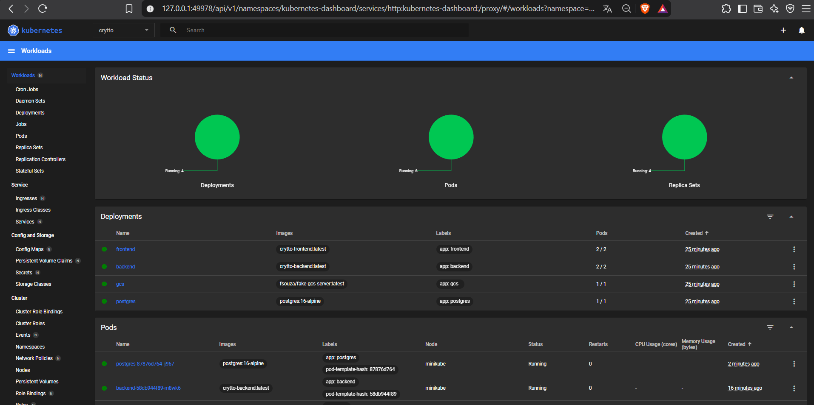
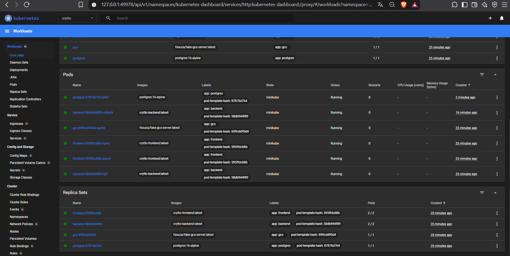
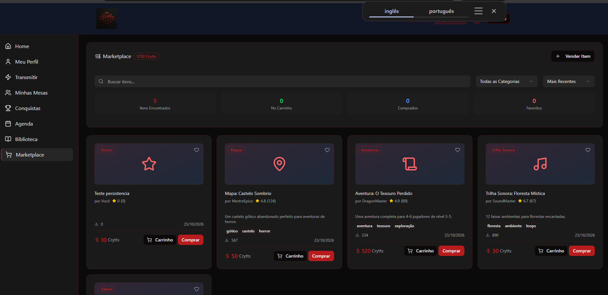
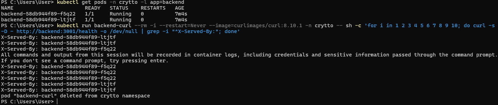
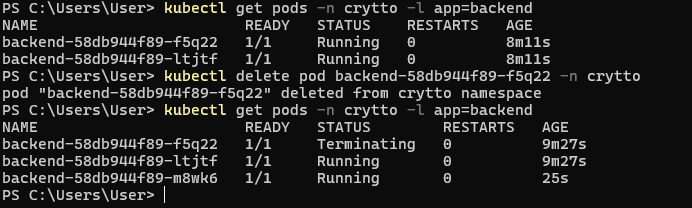
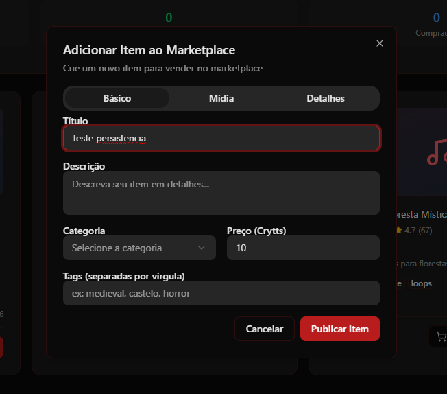
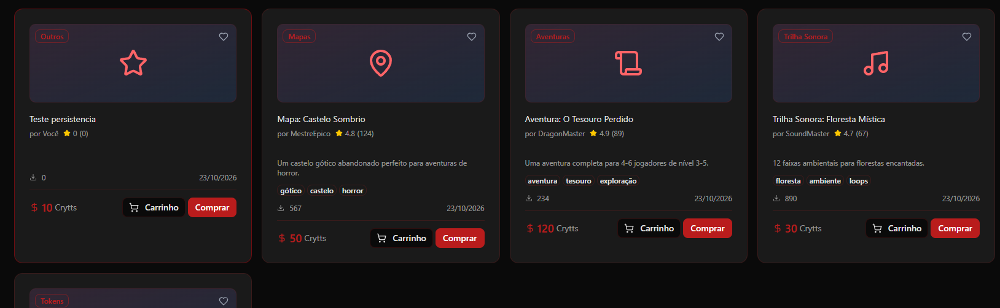
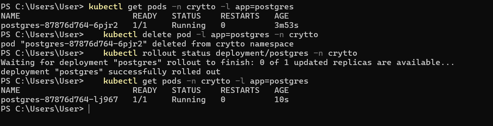

# Evidências da implantação no Minikube

Capturas reais da aplicação **Crytto RPG Platform** rodando no cluster Minikube, namespace `crytto`.
Para reproduzir, siga o passo a passo do [README](../../README.md#execução-no-kubernetes-minikube).

## 1. Cluster, Services, ConfigMaps e Secret

`minikube status` (cluster ligado), `kubectl get svc -n crytto` (`frontend` NodePort; `backend`, `postgres` e `gcs` ClusterIP) e `kubectl get configmap,secret -n crytto`:



## 2. Pods

`kubectl get pods -n crytto`: 6 Pods `Running` (2 frontend, 2 backend, postgres e gcs).



## 3. Services

Os 4 Services aparecem na [captura da seção 1](#1-cluster-services-configmaps-e-secret): o `frontend` é exposto por NodePort (`80:30080`) e os demais são internos (ClusterIP), acessados pelo nome do Service.

## 4. Deployments

Kubernetes Dashboard (`minikube dashboard`): os 4 Deployments com todos os Pods prontos (frontend 2/2, backend 2/2, gcs 1/1, postgres 1/1).



Pods e ReplicaSets do namespace `crytto`:



## 5. Aplicação em execução

Aplicação aberta no navegador pelo Service `frontend` (`minikube service frontend -n crytto --url`), com o Marketplace carregando os itens do Postgres pelo backend.



## 6. Réplicas e balanceamento de carga

O backend tem 2 réplicas. Dez chamadas ao Service `backend` foram atendidas pelos dois Pods: o header `X-Served-By` alterna entre `backend-...-ltjtf` e `backend-...-f5q22`.

```powershell
kubectl run backend-curl --rm -i --restart=Never --image=curlimages/curl:8.10.1 -n crytto -- sh -c 'for i in 1 2 3 4 5 6 7 8 9 10; do curl -s -D - http://backend:3001/health -o /dev/null | grep -i "^X-Served-By:"; done'
```



## 7. Recriação automática de Pod

O Pod `backend-...-f5q22` foi apagado e o Deployment criou automaticamente o `backend-...-m8wk6` para manter as 2 réplicas.



## 8. ConfigMap e Secret

A configuração do backend vem do ConfigMap `crytto-config` (7 chaves) e as credenciais do Secret `crytto-secret` (2 chaves). O nginx do frontend usa o ConfigMap `frontend-nginx-config`. Ver a [captura da seção 1](#1-cluster-services-configmaps-e-secret).

## 9. Persistência do banco (PVC)

1. Item "Teste persistencia" criado no Marketplace:

   

   

2. O Pod do Postgres foi apagado e recriado pelo Deployment (`postgres-...-6pjr2` → `postgres-...-lj967`):

   

3. Depois da recriação, o item continua no Marketplace (5 itens), pois os dados ficam no PersistentVolumeClaim:

   

---

## Como refazer as capturas

| Arquivo | Comando |
|---|---|
| `01-status-services-configmap-secret.png` | `minikube status`, `kubectl get svc -n crytto` e `kubectl get configmap,secret -n crytto` |
| `02-pods.png` | `kubectl get pods -n crytto` |
| `04-deployments-dashboard.png` | `minikube dashboard` (ou `kubectl get deployments -n crytto`) |
| `05-aplicacao-marketplace.png` | `minikube service frontend -n crytto --url` e abrir a URL |
| `07-balanceamento.png` | comando da seção 6 |
| `08-autorecuperacao.png` | `kubectl delete pod <pod-backend> -n crytto` e `kubectl get pods -n crytto -l app=backend` |
| `10*-persistencia*.png` | criar item no Marketplace, `kubectl delete pod -l app=postgres -n crytto`, recarregar a página |

Não inclua nas capturas valores de Secret, tokens ou arquivos `.env`.
